<div align="center">

<a href="https://itsyourap.dev"></a>

<a href="https://itsyourap.dev"></a>
<a href="mailto:contact@itsyourap.dev"></a>
<a href="https://linkedin.com/in/itsyourap"></a>
<a href="https://x.com/itsyourap"></a>
<a href="https://itsyourap.dev/blogs"></a>
<br />


</div>

### `$ cat ~/about.md`

I build **backend services and the infrastructure that runs them** — APIs, databases, containers, and the pipelines that tie them together. The aim is always the same: systems that are *reproducible, understandable, and easy to operate*.

```yaml
apiVersion: v1
kind: Engineer
metadata:
  name: ankan-pal
  location: West Bengal, India 🇮🇳
spec:
  role: Founding DevOps Engineer & Backend Developer
  company: ProjectX Infinity Inc. (YC P26)      # since Mar 2024
  working_on: InfinityOS — a cloud OS for application streaming
  practice: [backend-systems, cloud-infrastructure, delivery-automation]
  daily_driver: [go, terraform, kubernetes, docker, aws, azure, gcp]
  open_to: open-source collaboration
status:
  phase: Running
  motto: "Good systems begin with clear thinking."
```

### `$ ls ~/toolkit`



### `$ ls ~/projects --featured`

| Project | What it does | Built with |
| :-- | :-- | :-- |
| [**RusTone**](https://github.com/itsyourap/RusTone) | Native cross-platform SIP softphone (Windows/Linux/macOS, x64 & ARM64) — voice, video, messaging & presence over a statically linked pjproject stack. | `Rust` `pjproject` `egui` `SQLite` |
| [**triggerd**](https://github.com/itsyourap/triggerd) | Go daemon that turns ntfy notifications into allowlisted OS tasks via systemd, launchd or Task Scheduler — bounded dispatch, explicit failure handling. | `Go` `ntfy` `systemd` `GitHub Actions` |
| [**icloud-to-gphotos**](https://github.com/itsyourap/icloud-to-gphotos) | Resumable iCloud → Google Photos migration with a SQLite ledger, metadata fidelity and deletion gated on confirmed uploads. | `Python` `SQLite` `ExifTool` `systemd` |
| [**rtsp-human-capture**](https://github.com/itsyourap/rtsp-human-capture) | Real-time person detection & capture from RTSP camera streams, multi-stream and GPU accelerated. · [docs](https://rtsp-human-capture.docs.itsyourap.dev/) | `Python` `YOLOv4` `OpenCV` |

<sub>→ more case studies at <a href="https://itsyourap.dev">itsyourap.dev</a></sub>

### `$ gh stats --user itsyourap`

<p align="center">
  
  
</p>
<p align="center">
  
  
</p>
<p align="center">
  
</p>
<p align="center">
  
</p>

### `$ wakatime --last-7-days`

<p align="center">
  
</p>

### `$ tail -n 8 ~/activity.log`

<!--START_SECTION:activity-->
| When | | What |
| :-- | :-: | :-- |
| `Nov 08` | ⬆️ | Pushed to `main` in [itsyourap/icloud-to-gphotos](https://github.com/itsyourap/icloud-to-gphotos) |
| `Oct 21` | ⬆️ | Pushed to `master` in [itsyourap/pjproject](https://github.com/itsyourap/pjproject) |
| `Oct 21` | ⬆️ | Pushed to `jfc` in [JFC-Group/JFC-RusTone](https://github.com/JFC-Group/JFC-RusTone) |
| `Oct 21` | ⬆️ | Pushed to `main` in [JFC-Group/cloudflared-mipsle](https://github.com/JFC-Group/cloudflared-mipsle) |
| `Oct 21` | ⬆️ | Pushed to `main` in [itsyourap/tailscale-custom-builds](https://github.com/itsyourap/tailscale-custom-builds) |
| `Oct 21` | ⬆️ | Pushed to `main` in [itsyourap/RusTone](https://github.com/itsyourap/RusTone) |
<!--END_SECTION:activity-->

<details>
<summary><b><code>$ cat ~/.badges</code></b></summary>
<br />

[](https://holopin.io/@itsyourap)

<a href="https://instagram.com/itsyourap"></a>
<a href="https://stackoverflow.com/users/17178385"></a>
<a href="https://leetcode.com/itsyourap"></a>
<a href="https://auth.geeksforgeeks.org/user/itsyourap"></a>

</details>

<div align="center">
<br />

<a href="https://www.buymeacoffee.com/itsyourap"></a>

</div>
